# AhaDiff (知返)

> **Understand the change.**
>
> Start with Git changes, two file versions, a pasted diff, a saved local baseline, or one Markdown document. Study your own fixes, a colleague's edits, or AI-generated changes through evidence-linked lessons, quizzes, and spaced review.

[中文](./README.zh.md) · [Landing page](https://agi-is-going-to-arrive.github.io/ahadiff/) · [User Guide](./docs/USER_GUIDE.en.html) · [ English tutorial video (YouTube)](https://youtu.be/lvL7GMvDPvI) · [ Chinese tutorial video (Bilibili)](https://www.bilibili.com/video/BV1b57k6yEWm)

> Recommended: `pipx install ahadiff` (or `uv tool install ahadiff`) — an isolated CLI install. A plain `pip install ahadiff` also works inside a venv/conda; on a system or Homebrew Python, see [Install](#install) for the `externally-managed-environment` fix.

> Source update, 2026-09-08: the five-source WebUI, durable snapshots, format anchors, review notes, and active transfer practice described here are current source changes, pending publication. The version remains 1.3.8. Use a [source build](#from-source-contributors) for these UI updates; published installs already offer the CLI `--compare` and `--patch` paths.

---

## What it is

**AhaDiff** is a **local-first learning tool for understanding changes**.

Bring a bounded change or one Markdown document and generate:

- A **lesson** that teaches what changed and why
- A **claims ledger** with source anchors and explicit evidence strength
- A **quiz and review loop** so the knowledge comes back later
- A **quality history** that makes runs comparable over time

Your workspace keeps its state in `.ahadiff/`: run artifacts under `runs/`, and SRS / result history in `review.sqlite`. File comparisons, patches, snapshots, and documents also work in an ordinary folder without a Git repository.

| What you have | Where to start | Examples |
| --- | --- | --- |
| Changes in a Git repository | **Git changes** | A bug fix, a peer's commit, or AI-assisted coding |
| A before file and an after file | **Two files** | Coding exercises, SQL, configuration, Markdown, or two Notebook versions |
| A unified diff copied from a tool | **Paste a diff** | A review patch or edits shared by a colleague |
| A baseline you want to reuse later | **Saved snapshot** | Save the earlier file explicitly, then select the later file |
| One Markdown document | **One Markdown document** | Study quoted headings and paragraphs without a before version |

These sources use the same lessons, quizzes, review, and quality history. Document runs show the original document as evidence, without fabricated added or removed lines. A citation proves where source text occurs; interpreting it is a semantic judgment, and runtime behavior needs execution evidence. PDF and web-page capture are outside this single-Markdown pilot.

## Why

After fixing a bug, reading a review, or accepting an AI edit, you may still struggle to make a similar change yourself. AhaDiff gives you a way to study the change and return to it later:

1. **Understand the edit**: connect the explanation to the before and after versions.
2. **Inspect the evidence**: distinguish supported statements, weak evidence, and unproven conclusions.
3. **Knowledge should compound**: repeated concepts should build history and backlinks.
4. **Track lesson quality**: compare deterministic scores and hard gates across runs.

The original slogan, *Ship with AI. Learn it back.*, still describes one of these workflows.

## Prerequisites

- Python 3.11+ with Python's `sqlite3` runtime at SQLite 3.51.3+; patched backport branches 3.50.4+ and 3.44.6+ are also accepted. Check the Quick Start diagnostics, or run `ahadiff doctor` inside a Git repository, to inspect the runtime AhaDiff actually uses.
  - **A higher version number alone does not pass:** 3.51.0–3.51.2 are rejected (inside the 3.51 line but below 3.51.3, with no backport). **Windows users:** CPython's bundled `sqlite3.dll` is often below this gate even on recent Python builds — fix with conda/miniforge, replace `DLLs/sqlite3.dll` with a compatible SQLite build, or run under WSL. Inspect yours with `python -c "import sqlite3; print(sqlite3.sqlite_version)"`.
- Git on PATH for repository workflows. File and patch capture/preview do not require a Git repository or executable.
- An LLM provider: remote (OpenAI / Anthropic / Gemini / Azure / any OpenAI-compatible) with API key, or local (LM Studio / Ollama, no key needed)

## Install

AhaDiff is a CLI app, so the most reliable install is an **isolated** one — it never collides with a system or Homebrew Python (which blocks a bare `pip install` via [PEP 668](https://peps.python.org/pep-0668/)):

```bash
# Recommended — isolated, one command (pick either)
pipx install ahadiff        # no pipx yet?  brew install pipx  (macOS), or see https://pipx.pypa.io
uv tool install ahadiff     # no uv yet?    https://docs.astral.sh/uv/

ahadiff --version           # should print ahadiff 1.3.8
```
The published package bundles the WebUI for that release. The unpublished additions listed above require a current source build.

Inside a managed environment you control (a virtualenv, conda, or pyenv), a plain pip install is fine:

```bash
python3 -m venv .venv && source .venv/bin/activate   # Windows PowerShell: py -m venv .venv; .venv\Scripts\Activate.ps1
pip install ahadiff
```

FSRS parameter auto-optimization (a heavy torch dependency) is optional — install the extra with `pipx install 'ahadiff[optimizer]'` (or `uv tool install 'ahadiff[optimizer]'`; inside a venv/conda, `pip install 'ahadiff[optimizer]'`). Base review and scheduling work without it.

### Troubleshooting: `error: externally-managed-environment`

This is [PEP 668](https://peps.python.org/pep-0668/): Homebrew (macOS) and Debian/Ubuntu mark their system Python as "externally managed" and refuse a direct `pip install` — for any package, not just AhaDiff. Fixes, best first:

- **Isolated installer (recommended):** `pipx install ahadiff` or `uv tool install ahadiff`.
- **Virtualenv:** `python3 -m venv .venv && source .venv/bin/activate && pip install ahadiff` (Windows PowerShell: `py -m venv .venv; .venv\Scripts\Activate.ps1; pip install ahadiff`).
- **Last resort (not recommended):** `pip install --break-system-packages ahadiff` — this can break your Homebrew/system Python.

On Windows, the python.org installer is not externally managed, so `pip install ahadiff` works directly — but `pipx` / `uv tool` are still recommended for a clean, isolated CLI.

### From source (contributors)

Contributors building from source also need [uv](https://docs.astral.sh/uv/) (`curl -LsSf https://astral.sh/uv/install.sh | sh` or `brew install uv`) and pnpm. The `pip install` path above needs neither.

```bash
git clone https://github.com/AGI-is-going-to-arrive/ahadiff.git
cd ahadiff
uv tool install --editable .
cd viewer && pnpm install --frozen-lockfile && pnpm build   # builds the dev WebUI
```

## Your first lesson

Open a terminal in the folder where you want to keep your learning history. It can be an ordinary folder or a Git repository:

```bash
ahadiff serve
```
`ahadiff serve` creates local `.ahadiff/` state as needed and opens http://127.0.0.1:8765. Pass `--no-browser` to keep it headless. Ordinary folders do not need `ahadiff init`; the CLI `init` and `doctor` commands require a Git repository.

1. Add a provider in **Settings**, then open **Welcome**.
2. Choose **Git changes**, **Two files**, **Paste a diff**, **Saved snapshot**, or **One Markdown document**. For two files, select or drop the before and after versions into their respective fields; the filenames may match. For a snapshot, explicitly save the earlier file before choosing the later file.
3. Optionally add **Review notes**, or open **More options for this source** and enable **Active transfer practice**. The default remains a mixed quiz. Preview the sanitized diff or document text locally without an LLM call, then select **Start learning**. Changing an option requires a fresh preview.
4. Open **Lesson** for the explanation and its source evidence. Attempt **Quiz** questions before revealing the reference, then return to **Review** when cards are due.

For the browser file picker, use UTF-8 text files up to 256 KiB each (512 KiB for a pair). A saved snapshot file or standalone Markdown document keeps the 256 KiB limit in both CLI and WebUI. Two `.ipynb` files use cell-aware comparison; AhaDiff does not execute the notebook. The preview shows up to 64 KiB and labels truncation. Larger comparison files can use the CLI; snapshot and document limits remain fixed. Small file, patch, snapshot, or document exercises enable **Generate a lesson even for small changes** by default; you can clear it. This bypasses only the learnability skip, not evidence or safety checks.

Prefer the terminal? Configure a provider, keep both files or the patch inside your workspace, then choose one command:

```bash
ahadiff learn --compare before.py after.py --force-learn
ahadiff learn --patch change.diff --force-learn
ahadiff learn --last   # requires a Git repository with a commit
```

For optional automation after Git commits on macOS/Linux, see `ahadiff install hooks --auto-learn`.

Two more things to try:
```bash
ahadiff quiz <run_id>    # test yourself on what you just learned
ahadiff review           # spaced-repetition review of past cards
```
See the [User Guide](./docs/USER_GUIDE.en.html) for the 10 existing diff capture modes, snapshot/document inputs, export options, concept graphs, and advanced commands. Release validation records dry-run capture coverage separately from live LLM lesson generation; the v1.3.8 audit records the global-provider save regression and a live DeepSeek learn run.

## Save a baseline, study a document, or add review notes

**Save a baseline before editing.** In Welcome → Saved snapshot, choose one file, name it, and select **Save baseline locally**. Reopening the app restores the list. Choose **Use baseline**, select the later file, and preview the comparison. The list shows size and readiness; damaged or unsupported baselines cannot be used.

```bash
ahadiff snapshot save before.md --name "Before editing" --repo-root .
ahadiff snapshot list --repo-root .
ahadiff snapshot show SNAPSHOT_ID --expected-hash CONTENT_HASH --repo-root .
ahadiff learn --snapshot SNAPSHOT_ID --snapshot-hash CONTENT_HASH --after after.md --force-learn
```

Copy the ID and `content_hash` from the list. Snapshots are immutable, explicitly saved learning baselines under `.ahadiff/snapshots/`, limited to 100 records and 16 MiB of stored records. Secret filtering and text normalization happen before saving. They are not complete backups and never overwrite source files. To remove one, inspect its `record_hash` and confirm that specific deletion; existing runs are retained:

```bash
ahadiff snapshot delete SNAPSHOT_ID --expected-hash RECORD_HASH --repo-root .
```

**Study one Markdown document.** Choose One Markdown document, select one `.md` or `.markdown` file, preview its text, and start learning. CLI:

```bash
ahadiff learn --document reading.md
```

This is an independent `document` source, not an empty-file comparison. Lessons and questions cite its sections, paragraphs, and content hashes. The document can support a quotation without proving the truth of an external claim. Diff specification alignment is not available for document runs.

**Add human review context.** After choosing a change source, optionally enter Review notes, or use:

```bash
ahadiff learn --compare before.py after.py --review-context-file review-notes.md --force-learn
```

Notes are limited to 8 KiB of UTF-8 text, filtered as untrusted auxiliary input, and labeled separately from evidence. Their use and hash are recorded for the run; drafts do not enter task retry summaries. Input changes invalidate the preview.

**Request active transfer practice explicitly.** Open **More options for this source → Active transfer practice** before starting. It is off by default, preserving the guided/recall/transfer mix. When enabled, every question is open transfer practice; a quiz with at least 3 questions covers prediction, completion, and error explanation. Code is not executed. CLI examples:

```bash
ahadiff learn --document reading.md --active-practice
ahadiff learn --compare before.py after.py --active-practice --force-learn
ahadiff regenerate RUN_ID --only quiz --active-practice
```

`regenerate` replaces the selected run's quiz/cards, recomputes its deterministic score, and reseals its artifact checksums. Omitting both practice flags preserves that run's mode; `--mixed-practice` explicitly restores a mixed quiz. Old Judge results are invalidated and are not rerun automatically. Use the run ID whose quiz you intend to replace.

**Practice before revealing.** Transfer exercises reuse Quiz, Challenge, and SRS. Predict, complete, or explain first; then compare the reference and mark **Completed independently / Needed help / Not yet**, with an error category when needed. Written WebUI attempts stay in the page; saved signals contain bounded assessment and timing metadata. A delayed-recall attempt requires at least 24 hours since the prior recorded attempt. A first attempt counts as an unseen variant only when the question actually marks a new scenario. Challenge rehearses an original solution already viewed. Score/Judge describe artifact and evidence quality; this update does not establish learning gains from real participant measurements. Dashboard lists self-reported initial, delayed-recall, and unseen-variant rates with sample counts; an empty denominator is unmeasured. Its older SRS improvement ratio is not a transfer-learning success rate.

## Configure a provider

AhaDiff needs an LLM to generate lessons. The simplest setup is to run `ahadiff serve` in your working folder and add a provider in **Settings**. Choose a local model for `strict_local`, or explicitly select a remote privacy mode before using a remote provider. Installing an AI agent integration is optional.

For CLI setup inside an existing Git repository:
```bash
ahadiff init

# Register and test a provider (OpenAI-compatible example)
export OPENAI_API_KEY="<your-provider-api-key>"
export AHADIFF_PROVIDER_BASE_URL="<provider-base-url>"
ahadiff provider test \
  --name default \
  --provider-class openai \
  --base-url "$AHADIFF_PROVIDER_BASE_URL" \
  --api-key-env OPENAI_API_KEY
```
`provider test` sends a small probe request. If it succeeds, the provider is saved to `.ahadiff/config.toml`. When the provider exposes model limits, AhaDiff records split input / output limits; otherwise auto capture falls back to the bundled model registry or conservative defaults.

On this CLI path, `api_key_env` is the environment variable name, not the secret. Repo config accepts `AHADIFF_*` names and the common provider names (`OPENAI_API_KEY`, `ANTHROPIC_API_KEY`, `GEMINI_API_KEY`, `AZURE_OPENAI_API_KEY`). Identifier-shaped values are treated as environment-variable names and fail closed when unset, so a missing variable is not sent as a literal bearer token. `ahadiff provider test --api-key-env NAME` still uses an environment variable name, and now also resolves reference names defined in `.ahadiff/.env`.

In the Settings WebUI, you paste the plaintext API key directly instead of supplying an environment variable name. Here is what AhaDiff does with it:

- **Plaintext goes to one local file only.** It writes the key into the repo-local `.ahadiff/.env`, and stores only a reference name in `config.toml` (`api_key_env` is set to `AHADIFF_<UPPERCASE_ALIAS>_KEY`, with a numeric suffix like `AHADIFF_DEMO_2_KEY` if that name is already taken). The plaintext never lands in `config.toml`.
- **The key file stays out of Git.** AhaDiff makes sure the secret patterns (`.env`, `.env.*`, `audit.private.jsonl`, `*.lock`, `*.log`) stay git-ignored: it creates `.ahadiff/.gitignore` if it is missing, and if you already have one it appends only the missing secret lines (your existing lines are preserved). If `.ahadiff/.gitignore` is a symlink, hardlink, reparse point, or cannot be opened safely, saving fails before the key is written. Either way the key file is ignored by a normal `git add` (a forced `git add -f` could still override it).
- **File permissions.** On POSIX the file is `chmod 0600`. On Windows that mode isn't a POSIX owner-only ACL, so it's best-effort only — see the Windows note below.
- **A real OS env var wins.** At startup both `serve` and the CLI load `.ahadiff/.env` into the process environment, but a system variable of the same name takes precedence and is never overwritten.
- **Saving with a key entered runs a quick probe.** When you save with an API key in the field, AhaDiff checks provider connectivity; this is best-effort, so a failed probe does not block saving and the UI shows the result. Updating an existing provider with the key field left blank keeps the current key and skips the probe (verification is empty).
- **Delete cleans up after itself.** Removing a provider drops its `.ahadiff/.env` entry, but only unreferenced entries under the reserved `AHADIFF_` prefix. Shared names like `OPENAI_API_KEY`, and names another provider still uses, are left alone. Cleanup keys off the `AHADIFF_` prefix and reference count, so keep that prefix for AhaDiff and don't hand-author your own `AHADIFF_*` variables in `.ahadiff/.env`.

**Windows note:** the local `.ahadiff/.env` is protected by NTFS folder permissions rather than POSIX `0600`. For stricter handling, point `api_key_env` at a real OS environment variable (it takes precedence and is never written to `.ahadiff/.env`). For at-rest protection, use full-disk encryption such as BitLocker (or FileVault on macOS).

Supported provider classes: `openai`, `openai_responses`, `gemini`, `anthropic`, `azure`, `newapi`, `openai_compat`, `lmstudio`, `ollama`. Use `openai_compat` for OpenAI-compatible endpoints that should not receive native JSON schema payloads; for DeepSeek BYOK, use `base_url = "https://api.deepseek.com"` with `deepseek-v4-flash` or `deepseek-v4-pro`, and AhaDiff downgrades schema-aware calls on that route to JSON object mode. Advanced OpenAI-compatible or local setups can use `providers.<name>.capability_overrides` for known boolean capabilities such as native JSON schema support; invalid keys or non-boolean values are rejected. NewAPI disables `supports_native_json_schema` by default; if your NewAPI gateway backend actually supports native JSON schema, you can add `capability_overrides = { supports_native_json_schema = true }` in the provider config. Providers can live at repo scope or global scope. A repo alias with the same name overrides the global alias. In v1.3.8, Settings save-validation, provider list, capture estimate, and improve preflight all resolve aliases from the same merged repo + global config, so a global DeepSeek BYOK provider can be selected and saved without copying it into each repo. See [User Guide](./docs/USER_GUIDE.en.html) for details.

The Settings provider card can also preview model limits before you save, using only the draft provider class, model, base URL, and optional limits profile. It does not call the remote provider or read the API key for that preview. Leaving `max_output_tokens` empty means Auto; when a known trusted output max is exceeded, save-time config clamps it and returns a warning. Unknown, low-confidence, route-specific, or local-runtime limits are shown as warnings instead of being presented as hard facts. Official DeepSeek v4 models expose a Thinking Level control after the preview confirms support; for DeepSeek, `none` disables thinking, while `low`, `medium`, and `high` all map to the API's high effort. Ordinary OpenAI-compatible aggregators do not inherit that control unless the backend marks the route as supported.

For GPT-5.5 specifically, the bundled registry keeps two profiles: ordinary `openai` access budgets 400k context, while `openai_responses` / API access budgets 1.05M. A live probe can still override the registry when the endpoint reports a trustworthy total context.

> AhaDiff defaults to strict_local privacy: nothing leaves your machine unless you explicitly configure a remote provider.

## Features

- **Learn**: `ahadiff learn` supports 10 diff capture modes: working tree (`--staged --unstaged --include-untracked`), unstaged (`--unstaged`), staged (`--staged`), last commit (`--last`, or omit a capture-source flag), revision/range (`REVISION`), time-window (`--since`; optional `--author` focuses on one author and expects a single matching commit, otherwise it stops with a clear error), patch file/stdin (`--patch FILE|-`), patch URL (`--patch-url`), file compare (`--compare`), and directory compare (`--compare-dir`, macOS/Linux only). Recursive directory compare requires the secure directory file descriptor available on macOS/Linux. Patch files are resolved inside the workspace root; use stdin for external generated patches. Patch file/stdin and patch URL runs do not have a repository symbol index; when only hunk evidence is available, AhaDiff can still generate a lesson from weak diff-anchored claims instead of claiming symbol-level proof. In release validation, the 10-mode claim refers to capture coverage unless each live LLM lesson run is listed with its run ID and artifacts; v1.3.8 records the global-provider DeepSeek learn run separately from the older 10-mode matrix.
- **Evidence-linked claims**: Markdown headings/paragraphs, Notebook cell sources, and JSON/TOML/YAML key paths carry a side, location, content hash, and quoted text. Old hunk anchors remain supported. Unsupported structures retain explicitly weaker line evidence. Format indexes are capped at 4,096 anchors: a diff may expose a partial index while retaining hunk evidence; a document that exceeds the cap is rejected. Claim states distinguish verified, weak, not proven, contradicted, and rejected; source facts, semantic interpretations, and runtime effects are separate assertions.
- **Structured LLM output**: generation uses schema-aware JSON contracts where supported, defaults to JSON object mode with one bounded validation retry, and keeps the existing parser, repair, and degraded fallback paths. Truncated or malformed fallback JSON is retried instead of being accepted.
- **Adaptive capture limits**: fresh configs default to auto capture sizing; existing customized capture settings stay manual. Auto mode uses provider probes, the bundled model registry, output reserves, safety reserves, and CJK diff density, while runtime patch intake remains capped at 50 MiB. Settings previews provider limits from the current draft provider class, model, base URL, and optional limits profile before saving, without remote probing on every edit.
- **Quiz and review**: mixed guided/recall/transfer remains the default. Enable **Active transfer practice** (or pass `--active-practice`) to request open transfer questions, supporting predicting a next step, completing a similar example, and explaining an error. Attempt the question before revealing its reference and evidence. Choice checks are mechanical; open exercises use semantic self-assessment, with no code execution. `ahadiff review` brings back the same cards. Quiz count remains 3 by default, configurable from 1 to 30; adaptive mode defaults to 3–12.
- **Scoring**: each run gets an 8-dimension deterministic score, with an optional advisory LLM judge when configured. No-spec `spec_alignment` is shown as N/A / `0/0` and excluded from the overall score; judge results never override `score.json.verdict`. For diff runs, Diff Coverage uses visible `line_map.json` files and line-weighted hunks. Document runs mark Diff Coverage and change-novelty Learnability as N/A / `0/0`, exclude them from the overall score, and use a separate validated-anchor coverage gate. Hard-gate details record the applicable source policy. If the optional judge fails, the deterministic score is still kept and the failure is saved as a redacted `judge_failure.json`.
- **S1 / A3 diagnostics**: S1 semantic entailment is private shadow-only / measurement-only. Current S1 sample metrics are `route_hit=76` and `fp_rate=53.95%`, so both enforce and advisory use are blocked. A3 quiz distractor analysis is diagnostic/advisory-only and is not a blocking gate.
- **WebUI**: `ahadiff serve` opens Welcome, Dashboard, Lesson, Diff, Quiz, Review, Concepts, Run Detail, Settings, and Guide. The viewer uses a light, editorial paper-style theme, with fonts bundled locally so nothing loads from a CDN. Run Detail shows Score, Judge, Artifacts, and a sanitized judge-failure panel when the optional LLM judge could not complete. The Welcome Before/After demo keeps long raw diffs collapsed with a line count and a Show all / Collapse control; short or empty diffs stay simple.
- **Learning entry points**: Welcome, Quick Start, and Guide share **Git changes / Two files / Paste a diff / Saved snapshot / One Markdown document**. They open the same New Run dialog used by Dashboard. File selection and drop support feed the file-comparison pipeline, including Notebook cell sources; preview and generation use the same safety checks. Advanced options retain time windows, revision ranges, patch URLs, local file paths, and supported directory comparisons.
- **Export**: static previews retain the independent document/diff source, format anchors, and separately labeled review context. Read-only MCP exposes source/anchor provenance and bounded auxiliary excerpts. From the CLI, `ahadiff export-results` writes `results.tsv` and `ahadiff export preview` writes a local static preview bundle. The WebUI (and the `serve` API) also export TSV / JSON and Anki `.apkg`; `.apkg` export uses the bundled `genanki`, available by default.
- **Concept graph**: AhaDiff extracts cross-diff concepts and shows them in a Canvas graph with health checks.
- **AI tool integration**: one shared catalogue for 16 current CLI / IDE / CI targets, including Pi, DeepSeek Harness (developer preview), Grok Build, and Devin. Settings supports protected preview, write, update, and removal; Guide reads the same catalogue and reports loading/errors without inventing available targets. Gemini CLI remains an explicit install for API-key/Enterprise users; personal-account users should use Antigravity. Roo and old Windsurf guidance have cleanup-only entries.
- **Auto-iteration**: `ahadiff improve-run <run_id>` regenerates a lesson on an existing run and keeps the new copy only when the deterministic score strictly improves, saving it as a separate run and leaving the original untouched — this works in any install, including `pip`. The separate `ahadiff improve` command tunes AhaDiff's own generation prompts and only runs inside an AhaDiff source checkout.
- **Privacy**: three tiers: strict_local, redacted_remote, explicit_remote. The default is strict_local.
- **i18n**: English and Chinese for the WebUI and prompt output language. CLI help and most CLI diagnostics are in English.
- **Cross-platform**: macOS is the local validation platform for v1.3.8. Windows path and global-config behavior are covered by targeted unit tests; real Windows runtime status belongs to the release workflow. Antigravity remains Unknown/blocked until a real Antigravity check is run. `--compare-dir` and the `hooks` install target are macOS/Linux only. Installer writes and rollbacks use atomic replacement; POSIX restores file mode before replace, while Windows uses a best-effort mode restore after replace.
- **Validation scope**: v1.3.8 local validation in `docs/VALIDATION_AUDIT.zh.md` records backend unit/integration/eval, ruff/format/pyright, viewer typecheck/Vitest/build, i18n parity, real serve save reproduction, and a live DeepSeek learn run. GitHub Release and PyPI publish are tracked by the release workflow and `RELEASING.md`.
- **Security**: URL secret redaction, provider URL validation, provider API-key environment validation, input validation, prompt injection detection, safety hard gates, and redacted judge-failure reporting. WebUI-pasted keys are stored by reference: the plaintext is written only to `.ahadiff/.env` (POSIX `chmod 0600`; Windows best-effort) while `config.toml` keeps only the reference name, and AhaDiff makes sure the secret patterns stay git-ignored (creating `.ahadiff/.gitignore` if missing, or appending only the missing secret lines to an existing one). If the gitignore file is unsafe, saving fails before the key is written; otherwise the key file is ignored by a normal `git add` (a forced `git add -f` could still override it).

## Screenshots

<p align="center">
  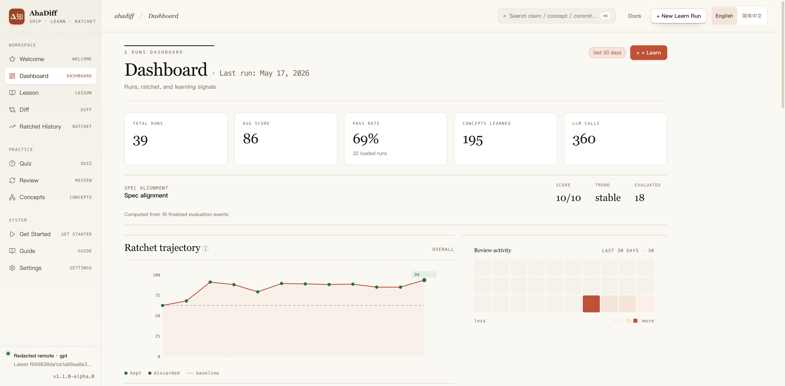
</p>

<details>
<summary>Welcome: first-run entry point</summary>
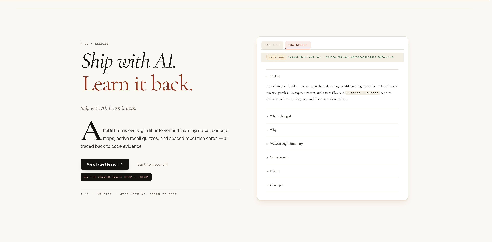
</details>

<details>
<summary>Lesson: AI-generated lesson from your diff</summary>
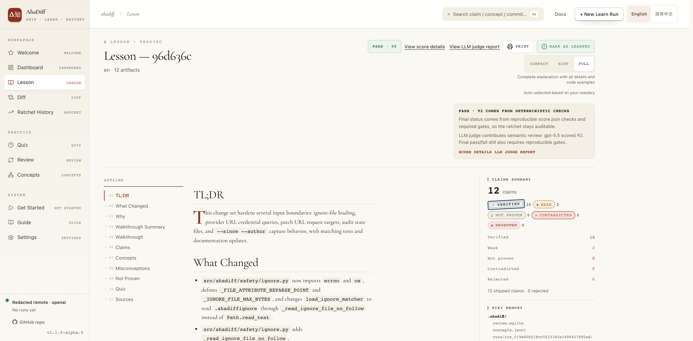
</details>

<details>
<summary>Diff Viewer: claim-linked code evidence</summary>
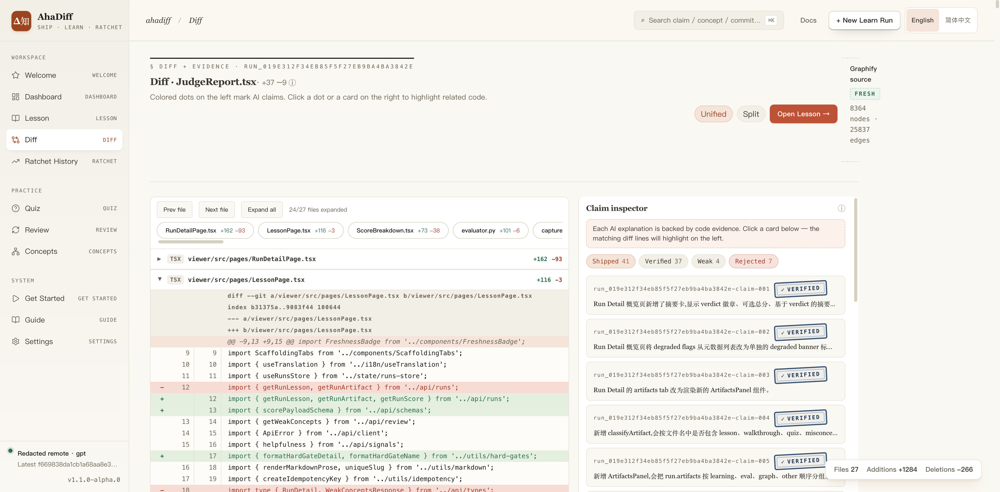
</details>

<details>
<summary>Quiz: active recall from the lesson</summary>
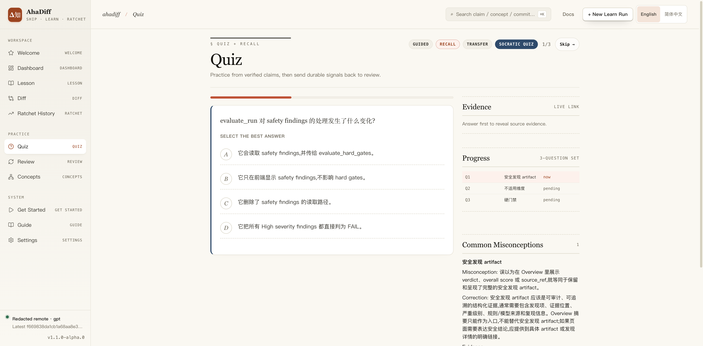
</details>

<details>
<summary>Review: spaced repetition cards</summary>
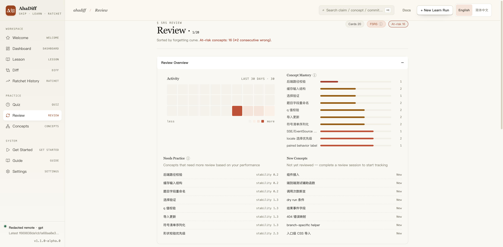
</details>

<details>
<summary>Concept Graph: cross-diff knowledge map</summary>
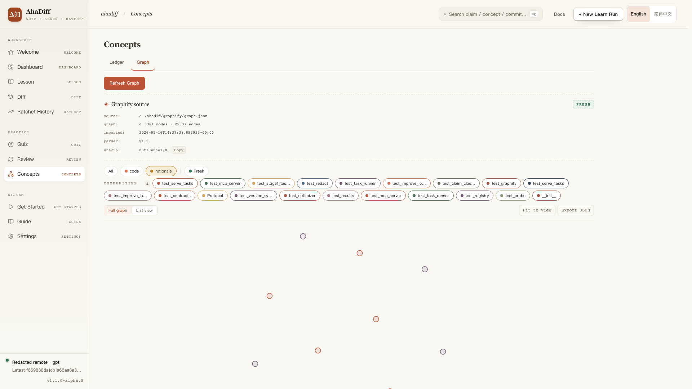
</details>

<details>
<summary>Concepts Ledger: learned concepts table</summary>
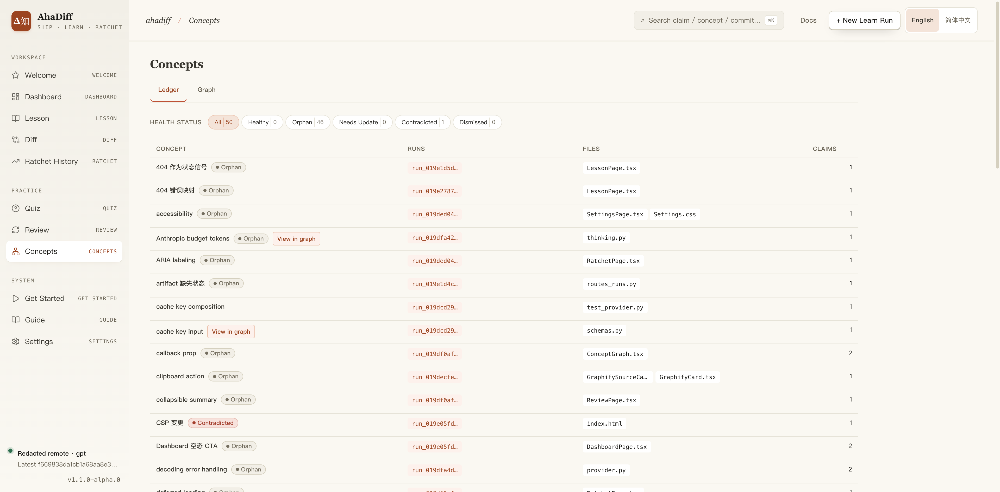
</details>

<details>
<summary>Run Detail: scores and evaluation breakdown</summary>
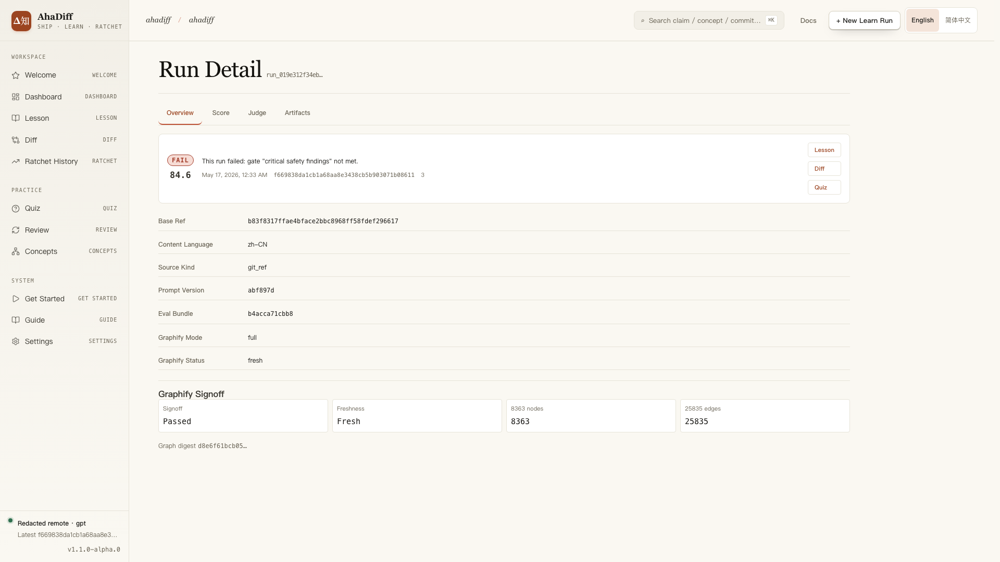
</details>

<details>
<summary>Run Detail Score: 8-dimension score breakdown</summary>
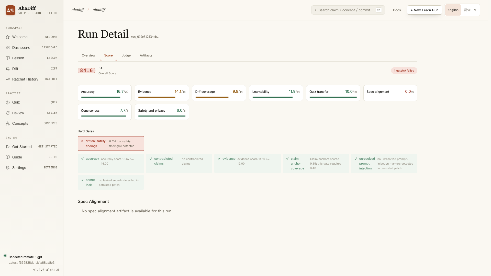
</details>

<details>
<summary>Settings: provider, preferences, and AI tool guidance</summary>
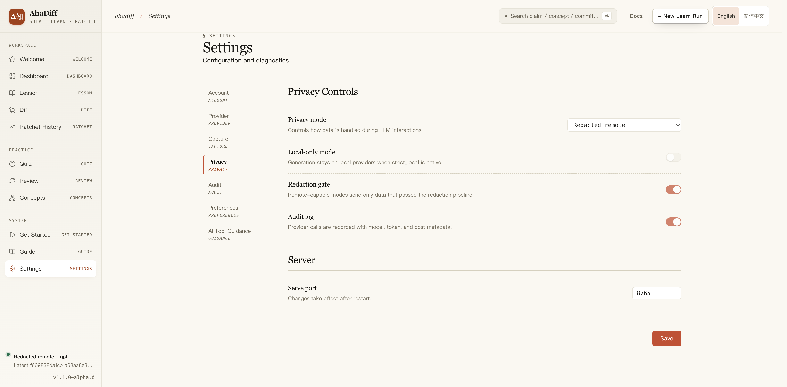
</details>

Model limits and thinking controls were reviewed on 2026-09-07. Model default and explicit thinking-off are separate settings; available controls depend on model and endpoint.

## AI tool integration

AhaDiff writes repo-local guidance files for the current project; it does not install the AhaDiff CLI again or write global user directories:
```bash
ahadiff install --detect        # auto-detect your tools
ahadiff install claude          # also: codex, pi, deepseek-harness, grok, devin, cursor, copilot, antigravity, ...
```
16 current targets. Use `ahadiff install --detect` to inspect project guidance, or open Settings → AI Tool Guidance. Explicit legacy cleanup uses `ahadiff uninstall roo` or `ahadiff uninstall windsurf`.

Git hooks stay reminder-only by default. `ahadiff install hooks --auto-learn` switches the post-commit hook to run `ahadiff learn --last` in the background (log: `.ahadiff/hooks.log`). GUI-client commits work too: the hook falls back to the install-time path, logs a skip if `ahadiff` is unreachable, and never blocks the commit. Prefer learning from saves instead of commits? `ahadiff watch` auto-learns on working-tree changes (2s debounce, 30s cooldown); `ahadiff serve --watch` runs the same watcher with the WebUI attached. Register the read-only MCP server (7 tools) with your agent:
```bash
claude mcp add ahadiff -- ahadiff mcp-server --repo-root <path>   # Claude Code
codex mcp add ahadiff -- ahadiff mcp-server --repo-root <path>    # Codex CLI
```

Settings groups targets into CLI / IDE / CI, shows quick-start steps, example prompts, expected behavior, platform notes, and a provider-free local demo. Guide uses the same usage hints inside default-collapsed tool cards and shows what files would be written before you apply changes; actual write/remove stays in Settings.

Guide and the New Run dialog keep cards, note markers, and footer actions readable in Windows high-contrast / forced-colors mode; usage hints use the same tokenized type scale as the rest of the viewer.

Some targets write tool-native generated files. Examples include `.claude/skills/ahadiff/SKILL.md`, `.agents/skills/ahadiff/SKILL.md`, `.gemini/skills/ahadiff/SKILL.md`, `.agents/skills/ahadiff-antigravity/SKILL.md`, `.agents/skills/ahadiff-antigravity-cli/SKILL.md`, `.agents/rules/ahadiff.md`, `.github/instructions/ahadiff.instructions.md`, `.opencode/agents/ahadiff.md`, `.clinerules/ahadiff.md`, `.continue/rules/ahadiff.md`, `.cursor/rules/ahadiff.mdc`, `.pi/skills/ahadiff/SKILL.md`, `.dsh/skills/ahadiff/SKILL.md`, `.grok/skills/ahadiff/SKILL.md`, and `.devin/rules/ahadiff.md`. Repo guidance sections stay in user-managed files such as `CLAUDE.md`, `AGENTS.md`, `GEMINI.md`, and `.github/copilot-instructions.md`. Uninstall only removes AhaDiff-generated files and AhaDiff marked sections.

This repository ignores generated `.agents/` installs, so repo-local Codex / Antigravity skill output remains local unless a user explicitly tracks it.

## 8-Dimension Rubric

| # | Dimension | Weight | Hard gate |
|---|-----------|--------|-----------|
| 1 | Accuracy | 20 | Base gate: < 14 → FAIL. Runtime policy may lower this threshold for very large visible diffs, but unsafe rejected-claim ratios and safety gates still block PASS. |
| 2 | Evidence | 18 | Base gate: < 12 → FAIL. Runtime policy may lower this threshold for very large visible diffs, but invalid or missing evidence still counts against the run. |
| 3 | Diff Coverage | 14 | Adaptive claim-anchor gate. Normal diffs fail below 7.70; large broad diffs use a lower threshold, while one/two-file many-hunk diffs use a stricter one. The exact ratio, regime, and visible basis are written into hard gate details. |
| 4 | Learnability | 14 | None |
| 5 | Quiz Transfer | 10 | None |
| 6 | Spec Alignment | 10 | None |
| 7 | Conciseness | 8 | None |
| 8 | Safety & Privacy | 6 | Unmitigated Critical → FAIL |

Three verdicts: **PASS** ≥ 80 / **CAUTION** 60–80 / **FAIL** < 60. Hard gates can still force **FAIL** even when the overall score is high; contradicted claims require zero tolerance, and unmitigated Critical safety findings fail the run.

## Repository Layout

```text
ahadiff/
├─ src/ahadiff/         # Python source
├─ viewer/              # React 19 frontend
├─ tests/               # Test suite
├─ prompts/             # LLM prompt templates
├─ benchmarks/          # Eval benchmark fixtures
├─ docs/                # Landing page, user guides, tutorial videos
├─ .github/workflows/   # CI/CD
├─ pyproject.toml       # Python package config
└─ LICENSE              # MIT
```

## Core Philosophy (N-File Contract)

AhaDiff extends the Karpathy / autoresearch three-file contract into an N-file variant:

| File | Who edits | Role |
|------|-----------|------|
| `program.md` | Human | Natural-language state machine for the improve loop |
| evaluation bundle | **Immutable** | `evaluator.py` + `rubric.py` + `rubric.yaml` + `gates.py` + `deterministic.py`, locked as a unit |
| `prompts/*.md` | Agent | The improve loop edits only allowlisted generation prompts; `eval_judge.md` is a judge prompt resource, not part of that writable set |

Loop: edit → commit → evaluate → keep if better, reset if worse → record the result for review and future runs.

## Inspirations, Design Axioms, and License

### Inspirations

- **karpathy/autoresearch**: N-file contract and git ratchet
- **alchaincyf/darwin-skill**: 8-dimension rubric and Phase 2.5 rewrite
- **Evol-ai/SkillCompass**: PASS / CAUTION / FAIL and weakest-dimension-first
- **ZJU-REAL/SkillZero**: helpfulness-driven retention and compact context
- **safishamsi/graphify**: repo-level graph overlay
- **karpathy/llm-wiki** gist: persistent compounding wiki

### Design Axioms

1. **Evidence first**: every supported claim must trace back to its source lines, structural locator, and content hash
2. **Learning over summary**: quizzes and review beat pretty summaries
3. **Local-first trust**: privacy tiers are explicit, and local stays local by default
4. **Paper-like seriousness**: academic feel, not a loud SaaS landing page
5. **One accent per style**: warm paper background plus a single accent color

### Acknowledgements

Thanks to the [linux.do](https://linux.do/) community for feedback and support.

### License

[MIT](./LICENSE)

---

> AhaDiff / 知返: Δ知 ↺
